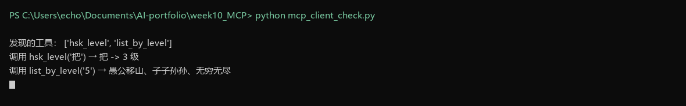

# W10 实验 3：MCP 实践记录（mcp_practice.md）

## 一、配置记录

- **运行环境**：Windows 11 / Python 3.11.9 / `mcp` 2.x
- **服务端**：`week10_MCP/hsk_mcp_server.py`（课程骨架原版，未改动）
- **客户端**：`week10_MCP/mcp_client_check.py`（自写的最小客户端，与讲义第五节的 `demo_client.py` 等价）
- **客户端配置原文**：

```python
from mcp import ClientSession, StdioServerParameters
from mcp.client.stdio import stdio_client

params = StdioServerParameters(command=sys.executable, args=["hsk_mcp_server.py"])
```

如果换成支持 MCP 的桌面客户端，配置就是一段 JSON（讲义片段 3 的写法）：

```json
{"mcpServers": {"hsk-tools": {"command": "python", "args": ["hsk_mcp_server.py"]}}}
```

> 注意：`args` 里的路径要写成服务端的实际位置；在 `week10_MCP` 目录下启动时就是文件名本身。

## 二、调用证据

### 2.1 服务端启动

在 `week10_MCP` 目录执行 `python hsk_mcp_server.py` 后，程序不返回、光标停住——这是 stdio 服务端在等客户端连接，属于正常状态。


### 2.2 客户端连上去：发现 → 调用

执行 `python mcp_client_check.py`，实际输出：

```
发现的工具： ['hsk_level', 'list_by_level']
调用 hsk_level('把') → 把 -> 3 级
调用 list_by_level('5') → 愚公移山、子子孙孙、无穷无尽
```



**对上了讲义给的三个预期值**：

| 验收项 | 期望 | 实际 |
|---|---|---|
| 工具列表 | `hsk_level` / `list_by_level` | ✅ 两个都在 |
| `hsk_level("把")` | 把 -> 3 级 | ✅ 一致 |
| `list_by_level` 按等级查 | 能返回该级词汇 | ✅ 5 级返回三个词 |

### 2.3 环境自检

```
PS C:\Users\echo\Documents\AI-portfolio> python -c "from mcp.server import MCPServer; print('mcp 2.x 路径 OK')"
mcp 2.x 路径 OK
```


## 三、三者辨析（照讲义第三节口径）

| | Function Calling | MCP | 普通 API 调用 |
|---|---|---|---|
| **在哪一侧** | 模型侧 | 工具侧 | 程序侧 |
| **解决什么** | 模型怎么「点名」要调哪个工具 | 工具怎么被统一发现和调用 | 代码怎么直接请求一个服务 |
| **谁定接口** | 模型与应用之间的调用格式 | 工具提供方与使用方之间的协议 | 服务提供方的 API 文档 |
| **本课程对应** | W9 `tool_agent.py` 的 `TOOLS` 字典与 `run()` | W10 `hsk_mcp_server.py` 与客户端配置 | W4 `week4_api_bot.py` 调 DeepSeek |
| **一句话** | 模型说「我要查等级」 | 查等级的工具长什么样、在哪 | 代码直接问服务要答案 |

**特别说明**：MCP 是 **Model Context Protocol（模型上下文协议）**，与第 5 讲的 **Quantization（量化）** 完全是两回事，只是缩写里都带 M/Q，容易看混。

## 四、动手时踩到的两个坑

**① mcp 2.x 里 `FastMCP` 已经改名**

按老教程写 `from mcp.server.fastmcp import FastMCP` 会直接报：

```
ModuleNotFoundError: No module named 'mcp.server.fastmcp'. This is mcp 2.x,
where FastMCP was renamed to MCPServer ...
```

骨架的两级 `try` 把它接住了——1.x 走 `fastmcp`，2.x 走 `MCPServer`，业务代码一行没改。这就是讲义说的「给上游写兼容层的最小示范」。

**② 把服务端放到后台跑，它会立刻退出**

在后台/管道里启动 `hsk_mcp_server.py`，stdin 是关闭的，stdio 服务端读到 EOF 就直接退出了（退出码 0），看起来像“启动失败”。**必须在真实终端窗口里跑**，才能看到它挂起等待的状态。

## 五、能力边界

服务端只暴露 `hsk_level` 与 `list_by_level` 两个工具。问这两个之外的事（比如“帮我算 35×24”），客户端拿不到对应工具——**工具的能力边界由服务端决定，不是模型「懂不懂」的问题**。这正是 MCP 要解决的核心：工具由谁提供、提供什么，写清楚在协议里。
