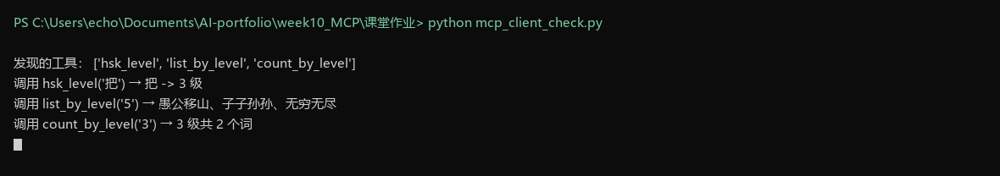

# 作业 2：给 hsk_mcp_server.py 加第 3 个工具

## 一、工具定义

| 项 | 内容 |
|---|---|
| 工具名 | `count_by_level` |
| 输入 | `level`（字符串，HSK 等级数字，如 `"3"`） |
| 输出 | `"<等级> 级共 <n> 个词"`；该等级没有收录时返回 `"<等级> 级暂无收录"` |

代码加在 `week10_MCP/课堂作业/hsk_mcp_server.py`：

```python
@mcp.tool()
def count_by_level(level: str) -> str:
    """统计某一 HSK 等级收录了多少个词。

    Args:
        level: HSK 等级数字，例如 "3"
    """
    words = [row["词汇"] for row in _rows() if row["HSK等级"] == str(level).strip()]
    if not words:
        return "%s 级暂无收录" % level
    return "%s 级共 %d 个词" % (level, len(words))
```

## 二、为什么选它

讲义给了两个推荐（`count_by_level` / `get_example`），我选前者的理由：

1. **和现有工具互补**：`list_by_level` 是「把词都列出来」，`count_by_level` 是「只告诉你有几个」。备课时常先想知道某级词汇量有多大，再决定要不要展开看词表。
2. **输入输出最简单**：一个字符串进，一句话出，正好检验「类型注解 + docstring」能不能被协议正确读出来。
3. **生词表只有 13 个词**，计数类的问题反而最能看出工具在真读数据——`count_by_level("3")` 返回 2，是因为表里 3 级只有「把」和「决定」。

## 三、验证：新工具出现在列表里

三件缺一不可——装饰器声明它是工具、类型注解声明参数、docstring 是给模型看的说明。加完用客户端连上去：

```
发现的工具： ['hsk_level', 'list_by_level', 'count_by_level']
调用 hsk_level('把') → 把 -> 3 级
调用 list_by_level('5') → 愚公移山、子子孙孙、无穷无尽
调用 count_by_level('3') → 3 级共 2 个词
```

**关键在第一行**：工具列表从两个变成三个，`count_by_level` 出现在里面，说明服务端确实把它注册成了 MCP 工具，而不是一个普通函数。



原始输出也存了一份：`验证输出.txt`。

## 四、数字对得上

生词表 13 个词的等级分布：

| 等级 | 词数 | 有没有验证 |
|---|---|---|
| 3 级 | 2（把、决定） | ✅ `count_by_level("3")` 返回 2 |
| 5 级 | 3（愚公移山、子子孙孙、无穷无尽） | ✅ `list_by_level("5")` 正好这三个 |

两个工具读的是同一份 `data/生词表.csv`，交叉验证一致——不是各自算各自的。
